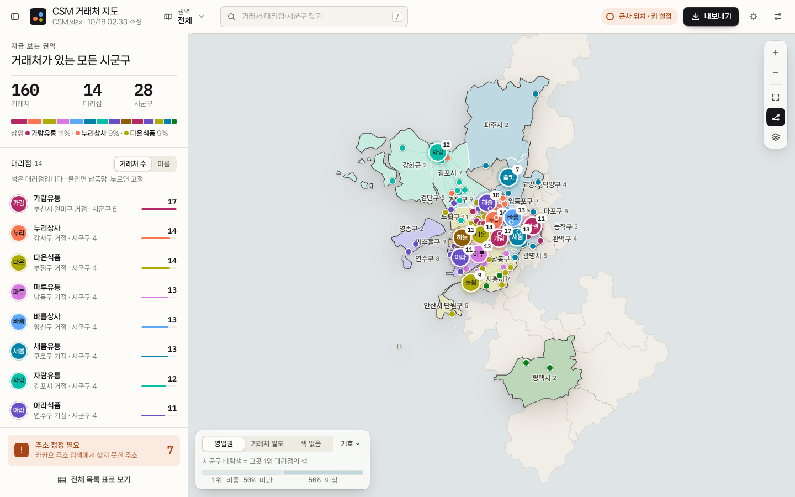
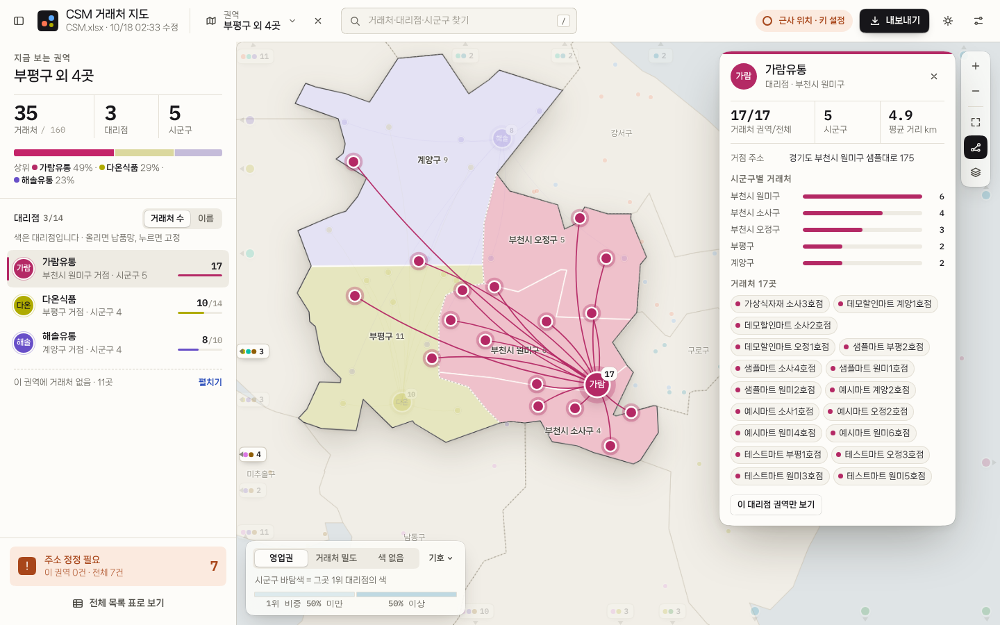

# CSM 거래처 지도

`CSM.xlsx`(대리점·거래처·주소)를 **같은 폴더에 두고 실행**하면 주소를 좌표로 바꿔(지오코딩)
**고른 권역만 새로 그린 시군구 지도** 위에 거래처를 대리점 색의 점으로, 대리점을 이니셜 거점으로 그려 주는 로컬 미니 앱입니다.
결과는 창 안에서 바로 보고, **파일 하나짜리 HTML** 로 내보내 공유할 수 있습니다.



```
CSM.xlsx ─▶ csm_map.py ─▶ 지오코딩(Kakao) ─▶ 시군구 귀속 ─▶ http://127.0.0.1:포트 (Edge 앱 창)
                                                          └▶ CSM_map_YYYY-MM-DD.html (단독 파일)
```

## 엑셀 양식

| 열 | 내용 | 비고 |
|---|---|---|
| B | 대리점명 | 거래처가 소속된 대리점 |
| C | 거래처명 | |
| D | 주소 | 도로명·지번 모두 가능. 괄호·층·호는 자동으로 떼고 재시도 |
| H | 대리점명 | 대리점 목록 |
| I | 대리점 주소 | **채우면 대리점 거점이 지도에 표시**되고, 올리면 납품 거래처까지 연결선이 그려짐 |

헤더(1행)의 글자로 열을 찾으므로 열 위치가 조금 달라도 됩니다. 폴더 안 `*.xlsx` 가 여러 개면 모두 합칩니다.

## 설치·실행

```
pip install -r requirements.txt      # openpyxl 하나뿐
python csm_map.py                    # 이 파일이 있는 폴더의 xlsx 로 앱 창 열기
python csm_map.py --folder D:\CSM    # 다른 폴더
python csm_map.py --demo             # 카카오 키 없이 시군구 중심 근사 좌표로 미리보기
python csm_map.py --export-only      # 창 없이 단독 HTML 만 생성
```

Windows 에선 `run.bat` 더블클릭. Edge(또는 Chrome)를 주소창 없는 **앱 창**으로 열며, 창을 닫으면 서버도 종료됩니다.

### Windows 휴대용 실행 (Python 설치 없이)

`python tools/make_portable.py --xlsx <CSM.xlsx 경로>` 로 `dist/CSM-Map-portable-날짜.zip` 을 만든다.
NuGet 의 공식 Windows Python(게시자 Python Software Foundation)을 받아 SHA512 를 검증하고, 의존성과 앱을 함께 묶는다.
받는 사람은 압축을 풀고 `run_csm_map.bat` 만 더블클릭하면 된다. 사용법은 zip 안의 `읽어주세요.txt` 참고.

### 카카오 REST API 키 (정확한 좌표를 얻으려면 필수)

1. [developers.kakao.com](https://developers.kakao.com) → 내 애플리케이션 → 앱 키 → **REST API 키** 복사
   (이미 긱뉴스 자동화용 앱이 있으면 같은 키를 쓰면 됩니다 — `docs/SETUP-KAKAO.md` 1단계)
2. 앱 창 우상단 ⚙ 설정 → 키 붙여넣기 → 저장. `config.json` 에 저장되며 환경변수 `KAKAO_REST_API_KEY` 도 인식합니다. (명령줄 인자로는 받지 않습니다 — 셸 기록에 남기 때문)
3. 결과는 `geocode_cache.json` 에 캐시되어 다음 실행부터는 새 주소만 조회합니다.

키가 없으면 **근사 모드**로 동작합니다: 주소에 적힌 시군구 중심 부근에 점선 링으로 표시합니다.

### 주소 검색 실패 → '정정 필요' 분류와 정정 요청

카카오 **주소 검색만** 씁니다. 원문과 괄호·층·호를 뗀 변형으로 다시 찾고, 그래도 없으면 **거래처명으로 대신 찾지 않고**
'정정 필요'로 따로 분류합니다(같은 이름의 다른 지점을 잡을 위험 때문). 주소 칸이 빈 거래처도 여기에 들어갑니다.

- 지도: 주소상 시군구 중심 부근에 **흐린 점선 마름모**로만 표시. 실제 위치가 아님을 툴팁에 적습니다.
- 왼쪽 레일 아래 「주소 정정 필요」: 대상 목록(사유·주소) + **정정 요청 엑셀 만들기** → `CSM_정정요청_날짜.xlsx`
  (번호·구분·대리점명·거래처명·현재 주소·사유·시군구·원본 위치·**수정 주소(노란 칸)**·비고, 안내 시트 포함).
- 담당자에게 받은 수정 주소를 CSM.xlsx(거래처 D열·대리점 I열)에 반영하고 앱을 다시 실행하면 그 주소만 새로 검색합니다.
- 검색 결과 없음도 캐시에 남겨 재실행 때 API 를 다시 부르지 않습니다. 강제로 다시 찾으려면 설정의 「전체 다시 지오코딩」.
- API 오류(키 거부·연결 실패)는 주소 문제가 아니므로 정정 대상이 아니라 '근사(미확인)'로 두고 캐시하지 않습니다.

## 화면 (v0.3 "Field Atlas")

크롬은 종이·잉크 단색, **색은 대리점 관계에만** 씁니다. 모서리와 가장자리는 macOS 문법(연속 곡률 모서리·동심 반경·머리카락 테두리·반투명 재질)을 따릅니다. 자세한 규범은 `docs/DESIGN.md`.

- **권역 버튼(상단)** 시도 → 시군구(거래처 수 순) 체크. 체크하는 즉시 지도가 그 권역으로 **새로 그려집니다**(전국 지도를 깔지 않음).
  이름 붙여 저장하면 다음 실행에도 유지. ✕ 로 해제. 지도에서 둘레의 흐린 시군구를 누르면 권역에 더하고, Shift+클릭으로 뺍니다.
- **지도** 고른 시군구는 그림자 진 '판'으로, 맞닿은 시군구는 흐린 맥락으로. 시군구 바탕색은 영업권(1위 대리점 색) / 거래처 밀도 / 색 없음 중 선택.
  권역 밖 거래처는 화면 안이면 흐린 작은 점, 화면 밖이면 **실제 방향의 가장자리에 ▲ 표시**(가까운 것끼리 묶음, 누르면 넓혀 보여 줌).
- **대리점 색** 26곳에 10색. 영업권이 겹치거나 맞닿은 대리점끼리는 잘 구분되는 색이 가도록 자동 배정하고, 이니셜·이름이 항상 함께 나옵니다.
- **대리점 거점** 올리면 그 대리점만 남고 연결선이 그려지듯 나타나며, 누르면 고정 + 상세 카드(시군구별 거래처, 평균 거리, 거래처 목록, "이 대리점 권역만 보기").
  거점끼리 겹치면 비켜 서고 가는 선으로 제자리를 가리킵니다.
- **왼쪽 레일** 지금 권역의 거래처·대리점·시군구 수, 대리점 비중 띠, 대리점 목록(거래처 수/이름 순), 주소 정정 필요, 전체 목록 표.
- **표** 이 권역만 ↔ 전체, 찾기, 열 정렬, CSV.
- **검색(`/`)** 시군구·대리점·거래처를 한 번에. 입력하는 동안 지도에서 해당 점이 강조됩니다.
- **내보내기** 단독 HTML(지도·데이터·글꼴 내장, 인터넷 없이 열림) / 정정 요청 xlsx / CSV.
- 라이트·다크, 온라인 배경지도(CARTO) 토글, 키보드: `/` 검색 · `R` 권역 · `F` 맞추기 · `L` 연결선 · `\` 레일 · `Esc` 닫기.



## 보안 메모 (로컬 앱이지만 브라우저가 공격면입니다)

같은 PC 의 브라우저에 열린 **다른 웹사이트**가 `127.0.0.1` 로 요청을 보낼 수 있으므로 다음을 적용했습니다.

- **1회성 토큰** — 서버가 기동마다 임의 토큰을 만들고, 앱 창을 여는 URL(`?t=…`)로만 전달합니다. 모든 `/api/*` 는 이 토큰(`X-CSM-Token` 헤더)이 없으면 401. 페이지는 토큰을 `sessionStorage` 로 옮기고 주소창에서 지웁니다.
  브라우저로 직접 열 때는 콘솔에 찍힌 **전체 주소**를 쓰세요.
- **Host·Origin 검사** — `127.0.0.1`/`localhost` 가 아닌 Host(DNS 리바인딩)나 다른 Origin 의 요청은 403. CORS preflight 는 항상 거부.
- **입력 검증** — 설정 값의 형·길이·허용값, 좌표 범위, 요청 본문 1MB 상한, 소켓 타임아웃 30초. 정적 파일은 `web/` 밖을 절대 읽지 않습니다.
- **폴더의 파일도 신뢰하지 않음** — 조작된 `geocode_cache.json`(비정상 precision·NaN 좌표·모르는 키), 50MB 초과 xlsx, 워크시트 없는 xlsx 는 건너뛰거나 경고로 처리하고 앱은 기동됩니다.
- **응답 헤더** — CSP(`script-src 'self'`, `frame-ancestors 'none'`), `nosniff`, `X-Frame-Options: DENY`, `Referrer-Policy: no-referrer`.
- **키 보관** — `config.json` 은 평문입니다(POSIX 에선 0600). 폴더를 OneDrive·공유 드라이브에 두면 키가 함께 동기화되니 주의하고,
  카카오 콘솔에서 REST API 키의 **허용 IP** 를 걸어 두면 유출돼도 피해가 제한됩니다. API 응답·로그·내보낸 HTML 에는 키가 들어가지 않습니다.
- **내보내기** — 단독 HTML 에는 거래처 데이터가 그대로 들어갑니다(로컬 경로·오류 문구·외부 글꼴 링크는 제외). 데이터는 `<` 를 모두 `\u003c` 로 써서 셀 값으로 페이지를 깨뜨릴 수 없습니다. 공유 범위를 확인하세요.
  CSV 는 `=`, `+`, `-`, `@` 로 시작하는 셀에 `'` 를 붙여 엑셀 수식 실행을 막습니다.
- **외부 요청** — 지오코딩(dapi.kakao.com)과, 켰을 때만 배경지도(CARTO) 뿐입니다. 글꼴(나눔스퀘어 네오 — 네이버 나눔 글꼴 라이선스, IBM Plex Mono — OFL)은 앱에 내장되어 있습니다.
- **API 키는 앱·zip 에 들어 있지 않습니다** — 키는 사용자가 설정 창에 넣은 값(또는 환경변수)만 쓰며 실행 폴더의 `config.json` 에만 저장됩니다.
  휴대용 zip 빌더(`tools/make_portable.py`)는 `config.json`·캐시·`.env`·32자리 16진 문자열이 섞여 들어가면 빌드를 멈춥니다.
- 남는 위험: 같은 PC 의 **다른 사용자 계정**은 프로세스 목록에서 토큰 URL 을 볼 수 있고, 같은 계정에서 도는 악성 프로그램은 어차피 파일을 직접 읽을 수 있습니다. 이 앱은 그 경계를 지키려는 것이 아니라 "브라우저 속 웹사이트" 경계를 지킵니다.

## 폴더에 생기는 파일

| 파일 | 내용 |
|---|---|
| `config.json` | API 키, 저장 필터, 테마 등 설정 |
| `geocode_cache.json` | 주소 → 좌표 캐시 |
| `overrides.json` | 지도에서 직접 지정한 좌표 |
| `CSM_map_YYYY-MM-DD.html` | 내보낸 단독 HTML |
| `CSM_geocoded_YYYY-MM-DD.csv` | 내보낸 CSV |
| `CSM_정정요청_YYYY-MM-DD.xlsx` | 정정 요청 목록 |

## Windows 실행파일 만들기

```
build\build_exe.bat        →  build\dist\csm_map.exe
```

`csm_map.exe` 를 `CSM.xlsx` 옆에 두고 더블클릭하면 됩니다. (PyInstaller 는 Windows 에서 빌드해야 Windows exe 가 나옵니다.)

## 경계 데이터

`web/data/boundaries.json` 은 [vuski/admdongkor](https://github.com/vuski/admdongkor) **ver20261001** 행정동 경계(통계청 자료 가공)를
시군구 256개로 결합하고 단순화한 TopoJSON(약 220KB)입니다. 2026-07 인천 개편(제물포구·영종구·서해구·검단구)과 부천 3구가 반영되어 있습니다.
갱신하려면 `python tools/build_boundaries.py` (node/npx 필요).

## 개발

```
pytest csm-map/tests                       # 110+ 테스트 (파서·지오코더·권역·색 배정·서버·내보내기·색 대비·휴대용 빌드)
python tools/make_fixture.py --rich <폴더>  # 화면 확인용 합성 데이터(가상 상호 약 160곳 + 좌표 캐시)
python csm_map.py --demo --no-browser --port 8765 --folder <폴더>   # 브라우저로 직접 열어 보기
```

디자인 규범은 `docs/DESIGN.md`("Field Atlas"). 스크린샷은 모두 합성 데이터로 찍었습니다.

## 한계·확인 사항

- 샌드박스에서 Kakao API 를 실제 호출해 보지는 못했습니다. 첫 실행 시 설정 → 키 저장 후 상단 진행 바와 하단 "주석"의 오류 문구를 확인하세요.
  401/403 이면 developers.kakao.com 에서 **카카오맵** 사용 설정이 켜져 있는지 확인합니다.
- Windows 의 실제 실행(휴대용 zip 의 `python.exe`·bat·Edge 앱 창)은 이 개발 환경에서 돌려 보지 못했습니다. 화면은 Linux Chromium 으로 1440·1024px 에서 점검했습니다.
- `--export-only` 로 만든 HTML 은 데이터가 그대로 들어 있으니 공유 범위에 주의하세요.
