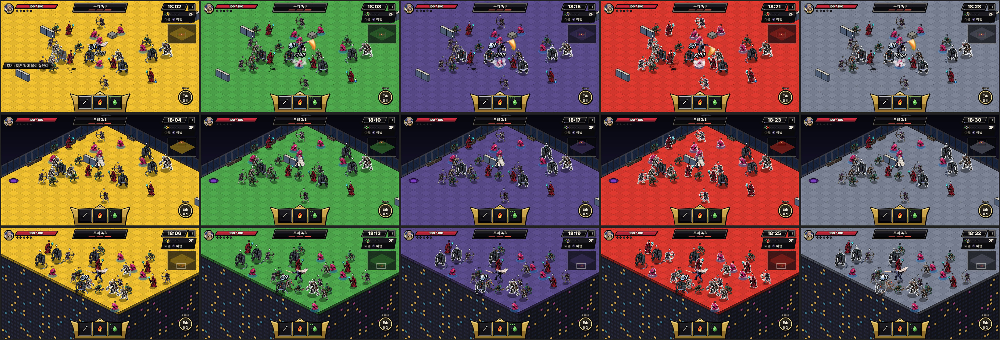
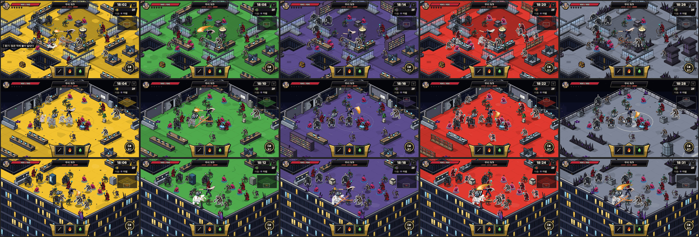
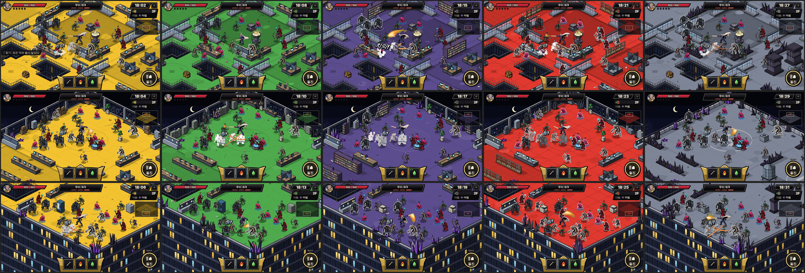

# Stage art rounds — 여명 전야 v2 (low-poly comic stage)

Each round: render the 48 × 48 stage at 1280 × 720 and 667 × 375 (device scale 2) on the five floor
colours from three spots (mid, back corner, front edge), put it beside
`docs/prior/style-reference-A.jpg`, write what still looks wrong, fix, render again.

Tools: `node tests/art/shoot.js <dir> [--engine] [--layout …]`, `node tests/art/sheet.js <png>`,
`node tests/art/perf.js [--art]`. Contact sheets are `sheet-<size>.jpg` in each folder
(rows = mid / back / front, columns = beast, undead, magic, heavy, rooftop).

## Before (`before/`, engine staging)

A flat checkerboard of identical tiles in the floor colour; obstacles are plain grey boxes; the
back walls are a thin dark strip with one desk; the facade below the slab edge is a field of
coloured dots; three purple triangles at the corners are the only demon-castle growth. On a
48 × 48 floor most of the screen is that checkerboard.

## Round 1 (`round1/`, showcase floor: all eight zone fills, office look)

First render of the new system: facet kit, prop catalogue sliced per cell, stage model inferring
props from SOLID cells, static painter (facade with storeys and lit windows, slab lip, flat floor
with seams/joints/wear/cracks/stones, cast shadows with halftone, curtain walls with pilasters and
the section cut, wall items, the broken elevator, furniture along the walls), flat sky bands with
three parallax skyline strips, sites. Frame time unchanged (below).

Found, against the reference:
1. Growths are far too small and sparse. The reference frames the stage with crystal and spike
   clusters taller than a character at the corners and along the walls and the slab edge.
2. The glass curtain wall reads as a black slab; the reference shows the lit city through it.
3. In the office look every boundary and the chamber are glass boxes of one height: the middle of
   the floor turns into rows of identical glass, busy and monotone.
4. The moon sits under the clock/minimap HUD; the open sky above the back walls is bare bands.
5. Floor types differ by colour and a few prop swaps only (bookshelves, weapon racks, dead
   shrubs). Not enough to tell beast from undead with the colour removed.
6. The prop sheet shows several multi-cell props at 1 × 1 (crate, crystal_mass, rubble, wall…).

Fixed for round 2: growth clusters 1.5–2× taller, tallest in the middle of a clump, corner masses
of 8–10 shards, clumps every ~4–6 u along the walls and the slab edge, a few crystals grown into
the facade, see-through when they cover the hero; the city painted into every glass pane
(towers, lit windows, signs) with smashed panes on the beast/undead floors; office glass
partitions lowered to 54 px; the moon moved clear of the HUD; floor types got their own wall
items (claws / cobwebs / sigils / shields and banners), furniture along the walls (crates, shelves,
weapon racks), litter against walls and props only (twigs, bones and candles, crystal shardlets,
bolts and chains, gravel and drains) and floors (beast claw gouges, undead cracks, magic cracks
that glow, heavy steel deck); the sheet shows multi-cell props at a representative size.

## Round 2 (`round2/`)

Side by side with the reference (`back-undead-1280x720.jpg`):
1. The floor is still too clean. The reference has big dark grime patches, rubble chunks and ink
   blots crowding the walls and the slab edge; ours had small faint patches spread evenly.
2. Solid wall bays are a light flat grey; the reference's concrete is darker, panelled, cracked.
3. The heavy floor's 2-u steel plates make a regular grid again, the thing the lead disliked.
4. 2 × 2 columns read as pedestals (base, shaft, capital, plaque) rather than structure.
5. Props' ink is thin at the game's zoom next to the reference's brush lines.
6. Frame time: the stairs door drew a halftone shard every frame, which made the browser raster
   the chunk blits synchronously (found by timing drawWorld's steps from inside).
