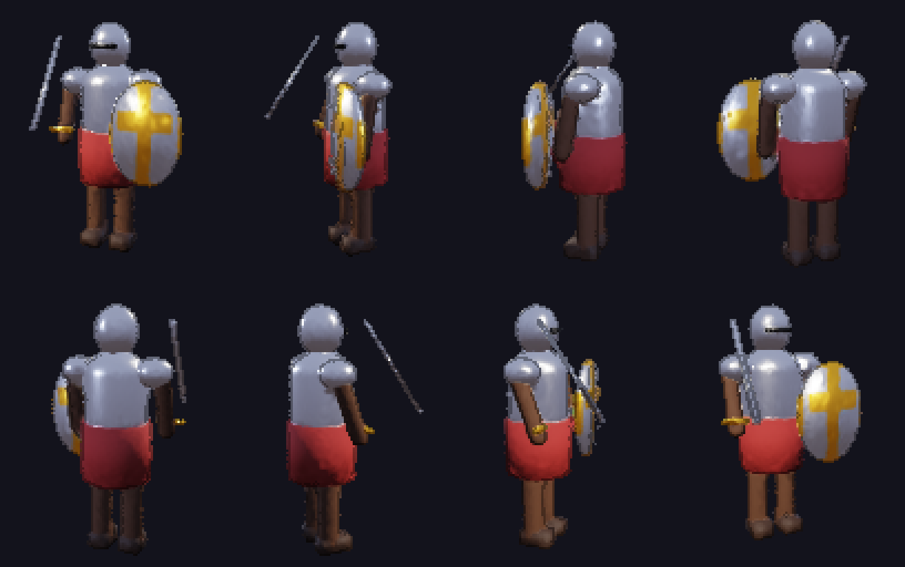
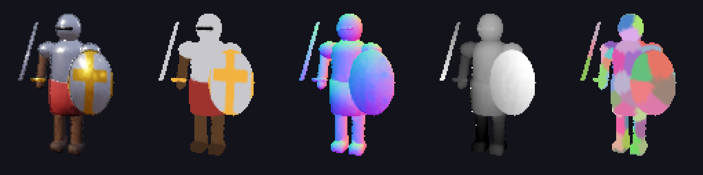

# pixel-splat — G-buffer Quad Splat 3D 픽셀아트

3D 모델(.glb / .gltf / .obj)을 **납작한 가우시안 splat 수만 개("quad splats")** 로 다시 표현합니다.
그 splat들이 색 대신 **G-buffer 전체(albedo·normal·depth·roughness·metallic·coverage)** 를 학습하므로,
저해상도로 렌더한 뒤 실시간 조명을 붙이면 **빛이 살아 움직이는 3D 픽셀아트**가 됩니다.
AI 필터가 아니라 진짜 3D 표현을 픽셀 격자에 직접 그리는 방식입니다.

동기: Tommaso Checchi(@_tomcc)의 "quad gaussian splats that learn the whole g-buffer" 데모(2026-11).
기법 분석과 근거 소스는 **[docs/ANALYSIS.md](docs/ANALYSIS.md)** 에 있습니다.

```
mesh ──▶ ① 정답 G-buffer 렌더 (48 시점)
     └─▶ ② 표면에 splat 뿌리기 ──▶ ③ 미분 가능 rasterizer로 G-buffer 비교·학습 ──▶ model.pt
model.pt ──▶ ④ (선택) patch snapping ──▶ ⑤ 저해상도 G-buffer ──▶ ⑥ deferred 조명 ──▶ ⑦ 픽셀 hacks ──▶ GIF/MP4
```




*위: 내장 데모 기사(primitive 조합)를 16k splat으로 학습 → 102×128px로 렌더. 아래: 같은 프레임의 G-buffer 채널과 snapping patch.*

## 빠른 시작

```bash
# 최초 1회 (저장소 루트에서)
uv venv .venv -p 3.13 && source .venv/bin/activate
uv pip install -r pixel-splat/requirements.txt

cd pixel-splat
# 내장 데모 기사로 전체 파이프라인 실행 (CPU에서 약 10~15분)
python -m pixelsplat demo -o out/demo

# 내 모델로
python -m pixelsplat bake  path/to/model.glb -o out/mine/model.pt
python -m pixelsplat render out/mine/model.pt -o out/mine
```

결과(`out/...`): `turntable.gif`, `turntable.mp4`, `sheet.png`(8컷 모음), `gbuffer.png`(lit·albedo·normal·depth·patch 디버그), `frames/`.

## 주요 옵션

### bake (학습)
| 옵션 | 기본값 | 설명 |
|---|---|---|
| `--splats` | 16000 | splat 개수. 많을수록 디테일이 살지만 느려집니다 |
| `--res` | 160 | 학습 해상도(px). 최종 픽셀아트 해상도보다 조금 크게 잡습니다 |
| `--iters` | 1500 | 학습 반복 횟수. `0`이면 mesh에서 바로 만든 초기값만 사용(빠른 미리보기) |
| `--patches` | 80 | snapping용 patch 개수 |
| `--up z` | y | Z축이 위인 모델(Blender export 등)일 때 |

### render (출력)
| 옵션 | 기본값 | 설명 |
|---|---|---|
| `--px` | 128 | **픽셀아트 세로 해상도**. 작을수록 픽셀이 굵어집니다 |
| `--scale` | 6 | 출력 확대 배율(nearest) |
| `--snap` | off | **Almost Pixel Perfect**: patch별 픽셀 격자 snapping |
| `--quad` | off | splat 모양을 둥근 가우시안 대신 **각진 사각형**으로 |
| `--hard` | off | 섞지 않고 맨 앞 splat의 색만 사용(색이 더 "픽셀"스러워짐) |
| `--outline` | 0.35 | 실루엣·깊이 경계 어둡게(0=끔) |
| `--palette` | 0 | N색 팔레트로 양자화(예: 24) |
| `--light-steps` | 0 | 조명을 N단계로 끊기(toon) |
| `--ortho` | off | 직교 카메라(원근 없음, 전통적 픽셀아트 시점) |
| `--elev` / `--fov` / `--frames` | 12 / 30 / 72 | 카메라 높이·화각·프레임 수 |

## 폴더 구조

```
pixelsplat/
  camera.py   카메라 (OpenCV 규약, 원근/직교를 3x4 행렬 하나로 통일)
  mesh.py     GLB/OBJ 로더(PBR 재질) + 데모 기사 생성기
  gt.py       정답 G-buffer용 numba z-buffer 렌더러, 표면 샘플링
  splats.py   splat 모델(위치·회전·크기·불투명도·재질)
  raster.py   ★ 미분 가능한 2D-가우시안(quad) tile rasterizer
  train.py    G-buffer 학습 + patch(k-means) 배정
  shade.py    deferred PBR 조명, 픽셀 hacks, patch snapping
  cli.py      명령줄
tests/        파이프라인 검증 (pytest, 약 15초)
docs/ANALYSIS.md  기법 분석·근거·한계
```

## 한계
- CPU 전용(PyTorch). GPU 환경이면 gsplat의 `rasterization_2dgs`로 교체해 수십 배 빠르게 만들 수 있습니다.
- 입력은 3D mesh여야 합니다. 사진만 있다면 카메라 포즈 추정(COLMAP)이나 image-to-3D 단계가 먼저 필요합니다.
- normal map 텍스처는 쓰지 않습니다.
