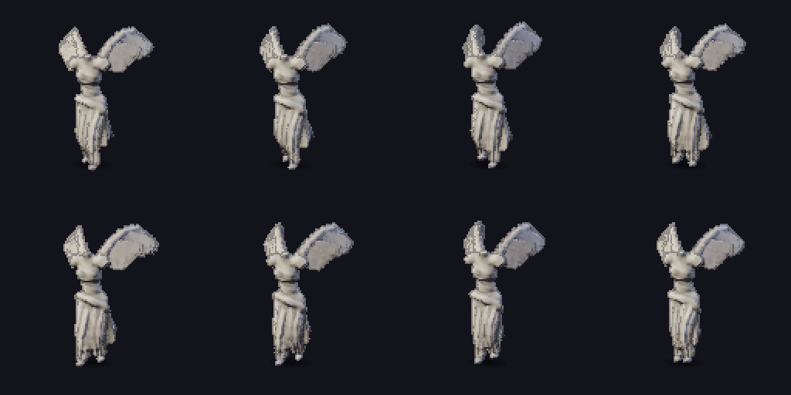

# 예제: 걷는 사모트라케의 니케 (Winged Victory)

루브르의 「사모트라케의 니케」(기원전 2세기 경)를 **quad splat 픽셀아트**로 만들고 자연스럽게 걷게 한 예제입니다.
3D 모델 파일 없이 사진만 참고했기 때문에, 조각상을 코드로 직접 **조형(sculpt)** 했습니다.





```bash
cd pixel-splat
python examples/nike/nike.py all -o out/nike     # 조형 → 학습 → 애니메이션 (CPU 약 25분)
# 단계별로
python examples/nike/nike.py sculpt  -o out/nike  # 1분: mesh + 미리보기
python examples/nike/nike.py bake    -o out/nike  # 12분: splat 학습
python examples/nike/nike.py animate -o out/nike  # 6분: 걷기 GIF/MP4
```

결과: `walk_cycle`(제자리 걷기 3/4뷰, 끊김 없는 loop) · `walk_across`(옆모습으로 화면을 가로질러 걷기, patch snap 켬) ·
`walk_orbit`(걸으면서 카메라 360° 회전 — 조명 변화 확인) 각각 `.gif`/`.mp4`, `walk_sheet.png`, `gbuffer.png`, `nike.glb`(조형 mesh).

## 어떻게 만들었나

### 1. 조형 — SDF¹로 점토 붙이듯
| 부위 | 만드는 법 |
|---|---|
| 몸통 | 타원체 3개(골반·배·흉곽) + 어깨 캡슐 + 가슴, 부드럽게 녹여 붙임(smooth union²) |
| 목·팔 | 원작처럼 **부러진 단면**: 기둥을 노이즈 섞인 평면으로 잘라냄 |
| 키톤(얇은 옷) | 몸에 달라붙은 사선 주름 = 사인파 굴곡을 노이즈로 휘게 해서 표면에 새김 |
| 히마티온(망토) | 허리에 비스듬히 감긴 두꺼운 천 롤 |
| 다리·치마 | 천에 싸인 다리 2개 + 다리 사이 천 + 굵은 사선 주름, 맨발 |
| 뒤로 날리는 천 | 엉덩이에서 뒤·아래로 흐르는 천 줄기 5개 + 천 판 |
| 날개 | 루브르 원작 사진(옆·정면) 기준. 앞날개 선은 어깨에서 **거의 수평으로 뒤로** 뻗으며 완만한 아치를 그리다 끝이 **아래로 말림**. 깃털은 아래로 늘어지되 끝으로 갈수록 뒤로 쓸림(15°→65°), 길이는 가운데가 가장 길어 **뒤로 누운 초승달** 윤곽. 밑판 + 긴 깃 24개(둥근 끝) + 비늘 같은 덮깃 3줄. 정면에서는 어깨 너비의 약 2.5배까지 V자로 벌어짐 |

→ marching cubes³로 약 24만 개 삼각형의 mesh를 만들고, **풍화된 파로스 대리석**으로 칠합니다(주름 속은 SDF ambient occlusion⁴으로 회색, 얼룩 노이즈, 약간 따뜻한 흰색).

### 2. 학습
서 있는 자세(rest pose)에서 28,000개의 quad splat으로 G-buffer를 학습합니다(1500 step).

### 3. 뼈대 + skinning⁵
뼈 12개: 골반·가슴·허벅지×2·정강이×2·발×2·날개×2·뒤 천.
splat마다 가까운 뼈들에 부드러운 가중치를 줍니다. 날개 splat은 날개 뼈와 가슴에만, 뒤 천은 천·골반·허벅지에만 붙도록 제한해서 엉뚱한 뼈를 따라가지 않게 했습니다.

### 4. 걷기 — "자연스럽게"를 위해 넣은 것
- **발이 미끄러지지 않음**: 발 위치를 먼저 정하고(땅에 닿은 60% 구간은 일정 속도로 뒤로, 나머지는 포물선으로 앞으로) **2-bone IK**⁶로 엉덩이·무릎 각도를 역산합니다. 몸 전체를 그 속도로 앞으로 보내면 발이 땅에 정확히 고정됩니다(`walk_across`).
- **발목**: 뒤꿈치 착지(발끝 들림) → 평평 → 뒤꿈치 들고 발끝으로 밀기.
- **골반**: 한 걸음에 한 번 위아래 출렁임(디딤발이 수직일 때 가장 높음), 디딤발 쪽으로 좌우 이동, 걷는 다리 방향으로 비틀림.
- **상체**: 골반과 **반대로 비틀림**(사람이 걸을 때처럼) + 원작처럼 바람을 안고 **앞으로 기울임**.
- **날개**: 걸음에 맞춰 살짝 펄럭이되 반 박자 늦게(관성).
- **뒤로 날리는 천**: 골반보다 늦게 흔들리는 2차 움직임.
- 발밑 **접지 그림자**(픽셀 단계로 끊은 타원).

---
¹ **SDF**: "이 점이 표면에서 얼마나 떨어져 있나"를 계산하는 수식으로 모양을 정의하는 방법
² **smooth union**: 두 모양을 이음매 없이 점토처럼 녹여 붙이기
³ **marching cubes**: SDF 같은 3D 수치 격자에서 표면을 삼각형 그물로 뽑아내는 알고리즘
⁴ **ambient occlusion**: 오목하게 파인 곳일수록 빛이 덜 들어 어두워지는 효과
⁵ **skinning**: 표면의 점들을 뼈에 붙여, 뼈가 움직이면 따라 움직이게 하는 기술
⁶ **IK(역운동학)**: "발을 여기 두고 싶다" → 관절 각도를 거꾸로 계산하는 방법
