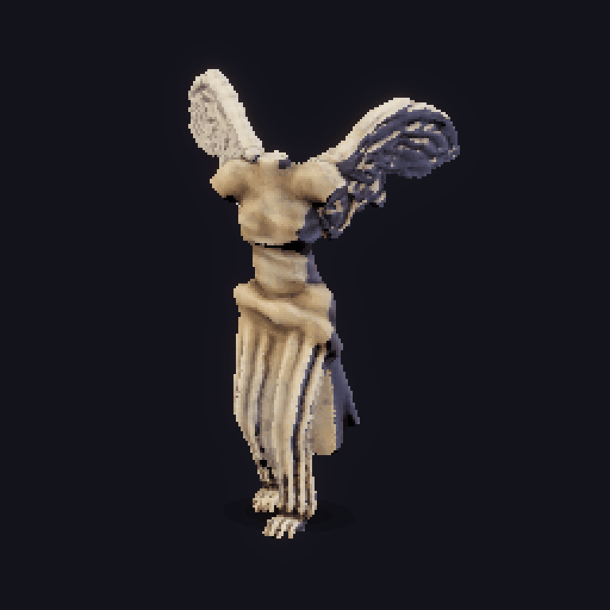

# 예제: 걷는 사모트라케의 니케 (Winged Victory)

루브르의 「사모트라케의 니케」(기원전 2세기 경)를 **quad splat 픽셀아트**로 만들고 자연스럽게 걷게 한 예제입니다.
3D 모델 파일 없이 사진만 참고했기 때문에, 조각상을 코드로 직접 **조형(sculpt)** 했습니다.


```bash
cd pixel-splat
python examples/nike/nike.py all -o out/nike     # 조형 → 학습 → 애니메이션 (CPU 약 25분)
# 단계별로
python examples/nike/nike.py sculpt  -o out/nike  # 1분: mesh + 미리보기
python examples/nike/nike.py bake    -o out/nike  # 12분: splat 학습
python examples/nike/nike.py animate -o out/nike  # 6분: 걷기 GIF/MP4
```

**Almost Pixel Perfect 버전**: `python examples/nike/nike.py animate -o out/nike --app` → `walk_cycle_app` · `walk_across_app` · `walk_orbit_app` (아래 설명 참고)

결과: `walk_cycle`(제자리 걷기 3/4뷰, 끊김 없는 loop) · `walk_across`(옆모습으로 화면을 가로질러 걷기, patch snap 켬) ·
`walk_orbit`(걸으면서 카메라 360° 회전 — 조명 변화 확인) 각각 `.gif`/`.mp4`, `walk_sheet.png`, `gbuffer.png`, `nike.glb`(조형 mesh).

## 어떻게 만들었나

### 1. 조형 — SDF¹로 점토 붙이듯
| 부위 | 만드는 법 |
|---|---|
| 몸통 | 타원체 3개(골반·배·흉곽) + 어깨 캡슐 + 가슴, 부드럽게 녹여 붙임(smooth union²) |
| 목·팔 | 원작처럼 **부러진 단면**: 기둥을 노이즈 섞인 평면으로 잘라냄 |
| 키톤(얇은 옷) | 몸에 달라붙은 사선 주름 = 사인파 굴곡을 노이즈로 휘게 해서 표면에 새김 |
| 히마티온(망토) | 허리에 비스듬히 감긴 두꺼운 천 롤 |
| 다리·치마 | 천에 싸인 다리 2개 + 다리 사이 천 + 굵은 사선 주름, 맨발 |
| 뒤로 날리는 천 | 엉덩이에서 뒤·아래로 흐르는 천 줄기 5개 + 천 판 |
| 날개 | 원본 사진 여러 각도로 검증한 형태(아래 "날개 검증" 참고). 좌우가 **비대칭**: 왼쪽(원본 대리석)은 목 높이 근처에서 끝이 뾰족하게, 오른쪽(석고 복원)은 더 높고 길게 내려오며 색이 더 희고 매끈함. 옆에서 본 길이는 몸 높이의 약 0.54배. 밑판 + 긴 깃 24개 + 덮깃 3줄 |

→ marching cubes³로 약 24만 개 삼각형의 mesh를 만들고, **풍화된 파로스 대리석**으로 칠합니다(주름 속은 SDF ambient occlusion⁴으로 회색, 얼룩 노이즈, 약간 따뜻한 흰색).

### 2. 학습
서 있는 자세(rest pose)에서 28,000개의 quad splat으로 G-buffer를 학습합니다(1500 step).

### 3. 뼈대 + skinning⁵
뼈 12개: 골반·가슴·허벅지×2·정강이×2·발×2·날개×2·뒤 천.
splat마다 가까운 뼈들에 부드러운 가중치를 줍니다. 날개 splat은 날개 뼈와 가슴에만, 뒤 천은 천·골반·허벅지에만 붙도록 제한해서 엉뚱한 뼈를 따라가지 않게 했습니다.

### 4. 걷기 — "자연스럽게"를 위해 넣은 것
- **발이 미끄러지지 않음**: 발 위치를 먼저 정하고(땅에 닿은 60% 구간은 일정 속도로 뒤로, 나머지는 포물선으로 앞으로) **2-bone IK**⁶로 엉덩이·무릎 각도를 역산합니다. 몸 전체를 그 속도로 앞으로 보내면 발이 땅에 정확히 고정됩니다(`walk_across`).
- **발목**: 뒤꿈치 착지(발끝 들림) → 평평 → 뒤꿈치 들고 발끝으로 밀기.
- **골반**: 한 걸음에 한 번 위아래 출렁임(디딤발이 수직일 때 가장 높음), 디딤발 쪽으로 좌우 이동, 걷는 다리 방향으로 비틀림.
- **상체**: 골반과 **반대로 비틀림**(사람이 걸을 때처럼) + 원작처럼 바람을 안고 **앞으로 기울임**.
- **날개**: 걸음에 맞춰 살짝 펄럭이되 반 박자 늦게(관성).
- **뒤로 날리는 천**: 골반보다 늦게 흔들리는 2차 움직임.
- 발밑 **접지 그림자**(픽셀 단계로 끊은 타원).

---
¹ **SDF**: "이 점이 표면에서 얼마나 떨어져 있나"를 계산하는 수식으로 모양을 정의하는 방법
² **smooth union**: 두 모양을 이음매 없이 점토처럼 녹여 붙이기
³ **marching cubes**: SDF 같은 3D 수치 격자에서 표면을 삼각형 그물로 뽑아내는 알고리즘
⁴ **ambient occlusion**: 오목하게 파인 곳일수록 빛이 덜 들어 어두워지는 효과
⁵ **skinning**: 표면의 점들을 뼈에 붙여, 뼈가 움직이면 따라 움직이게 하는 기술
⁶ **IK(역운동학)**: "발을 여기 두고 싶다" → 관절 각도를 거꾸로 계산하는 방법

### 5. Almost Pixel Perfect (`--app`)




tomcc가 말한 "모델의 patch를 화면 픽셀 격자에 snap한 뒤 다시 합치는" 방식을 애니메이션에 맞게 구현했습니다.
1. **뼈 기준 patch**: splat을 주로 따르는 뼈별로 묶은 뒤, 각 묶음을 k-means로 쪼갭니다(총 81개). 한 patch가 무릎·허리처럼 서로 다르게 움직이는 부분을 걸치지 않으므로, 거의 한 덩어리로 움직입니다.
2. **snap**: 매 프레임 patch 중심을 화면에 투영하고, 픽셀 중앙까지 남은 오차(0.5px 이하)만큼 patch 전체를 화면에서 옮깁니다. 그러면 patch 안의 픽셀 무늬가 정수 픽셀 단위로만 움직입니다.
3. **섞지 않고 합치기**: 픽셀마다 맨 앞의 splat 하나만 씁니다(`hard`). patch 경계에서 반투명하게 섞이지 않아 픽셀이 또렷합니다.

실측(프레임 사이 색이 바뀐 픽셀 비율, 128px 옆모습, 16프레임):

| 상황 | 기존 | hard만 | APP |
|---|---|---|---|
| 자세 고정, 0.3px씩 이동 | 44.6% | 45.9% | **28.4%** |
| 실제로 걸으며 카메라가 따라감 | 51.5% | 52.9% | **49.6%** |

이동에는 확실히 효과가 있습니다. 걷기에서는 팔다리가 실제로 움직여 생기는 변화가 대부분이라 차이가 작습니다.
patch 경계에서는 이웃 patch가 서로 다른 순간에 1px씩 점프하므로 이음매 노이즈가 남습니다. tomcc가 "too noisy"라고 한 지점이고, 그래서 "Almost"입니다.

## 날개 검증 (원본 사진 대조)

처음 두 번의 조형은 사진 한두 장만 보고 만들어 날개가 **너무 길고, 좌우 대칭**이었습니다. 원본 사진을 추가로 확보해 다시 검증했습니다.

**확보한 자료** (Wikimedia Commons, 각 파일의 라이선스는 Commons 페이지 참고 — 사진은 이 repo에 넣지 않았습니다)
- 정면·왼쪽 옆: 사용자가 제공한 사진 2장
- 뒷모습: `WingedVictoryBack.jpg`, `Nike Samothrace 001.jpg`, `Rückseite Abguss Nike MfA.jpg`(뮌헨의 석고 복제본)
- 오른쪽 옆·뒤: `Winged Victory of Samothrace side.jpg`, `Victoire de Samothrace - vue de droite, gros plan de la statue.JPG`, `Nike of Samothrace 01.jpg`
- 왼쪽 옆·앞: `Nike of Samothrake Louvre Ma2369 n4.jpg`, `…n2.jpg`, `Winged Victory Side.jpg`, `Wings of Samothrace 2011.jpg`
- 날개 세부: `Wing victory Samothrace Louvre Ma2369.jpg`(석고 날개 안쪽의 금속 뼈대), `Louvre - the wings (9132123944).jpg`
- 보존 부분 도해: `Victoire de Samothrace parties conservées de la statue.jpg` (원본으로 남은 날개는 **하나**)

**사진에서 잰 값** (몸 단위: 목~발 = 1.64)

| 항목 | 원본 | 이전 모델 | 수정 후 |
|---|---|---|---|
| 옆에서 본 날개 길이 ÷ 몸 높이 | 약 0.54 | 0.7~0.85 | 0.54 |
| 날개 가운데 깊이(깃털 길이) | 약 0.38 | 0.52 | 0.40 / 0.46 |
| 정면에서 어깨 밖으로 나온 폭 | 약 0.45 (좌우 같음) | 0.5 + 깃털 퍼짐 | 0.45 |
| 정면에서 본 높이 범위 | 목 높이 ~ 허리 망토 바로 위 | 어깨 위로 솟고 짧음 | 목 높이 ~ 허리 위 |
| 좌우 차이 | 오른쪽이 약 25% 더 높고 길게 보임, 왼쪽은 끝이 뾰족 | 완전 대칭 | 오른쪽 꼭대기 +0.05, 깃털 +10~15% |
| 재질 | 오른쪽은 석고(더 희고 매끈) | 같은 대리석 | 오른쪽을 밝은 회백색으로 |

**알게 된 사실**
- 오른쪽 날개는 1880년대에 **왼쪽 날개를 뒤집어 석고로 뜬 복원품**입니다(검색 결과: Louvre 복원 기록 요약, World History Encyclopedia 등). 그래서 위에서 본 벌어짐은 좌우가 같고, 실제 차이는 설치 높이·보이는 크기·재질에 있습니다.
- 자료에 따르면 원래 오른쪽 날개는 지금보다 **더 높이 들려 있었을** 것이라고 합니다. 이 모델은 "원래 모습"이 아니라 **현재 루브르에 전시된 모습**을 따릅니다.
- 뒷모습 복제본 사진에서 보이는 큰 좌우 차이는 촬영 위치가 약 7° 비껴서 생긴 것으로 계산됩니다(같은 평면 형태로 정면·뒷면 수치가 모두 설명됨).

**한계**: 3D 스캔 데이터가 아니라 사진 대조이므로 오차가 있습니다(카메라 높이·각도를 추정해 보정). 깃털 하나하나의 배치나 날개 두께는 원본과 다릅니다.
