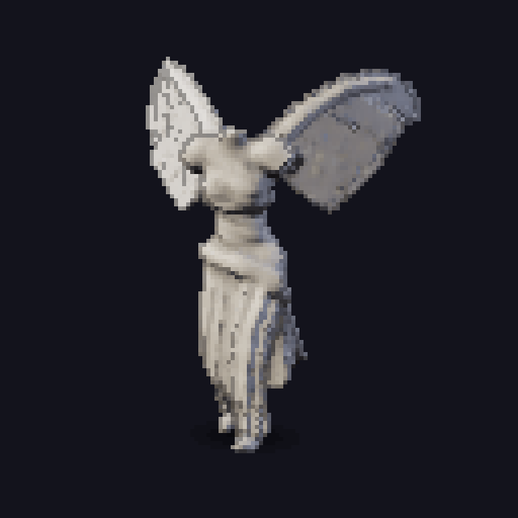
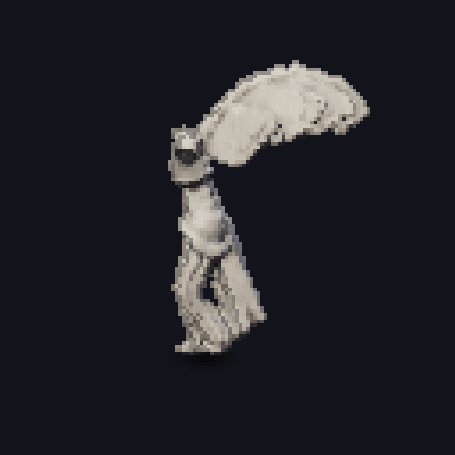
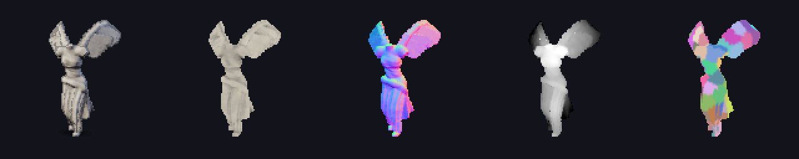
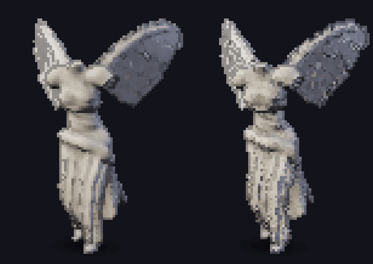
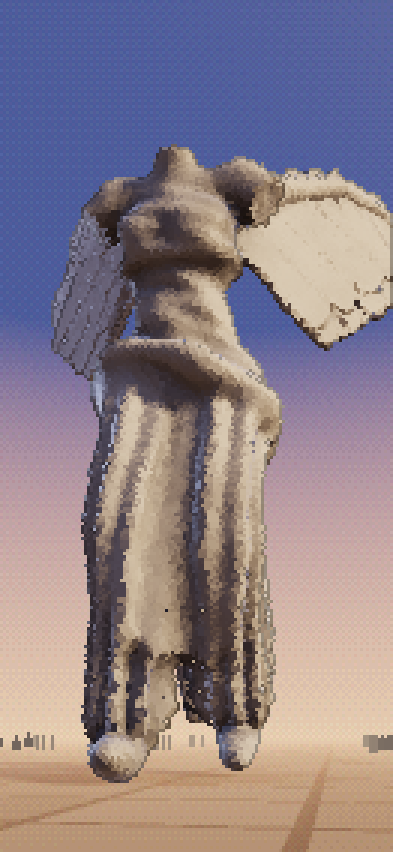

# 예제: 걷는 사모트라케의 니케 (Winged Victory)

루브르의 「사모트라케의 니케」(기원전 2세기 경)를 **quad splat 픽셀아트**로 만들고 자연스럽게 걷게 한 예제입니다.
3D 모델 파일 없이 사진만 참고했기 때문에, 조각상을 코드로 직접 **조형(sculpt)** 했습니다.






```bash
cd pixel-splat
python examples/nike/nike.py all -o out/nike     # 조형 → 학습 → 애니메이션 (CPU 약 25분)
# 단계별로
python examples/nike/nike.py sculpt  -o out/nike  # 1분: mesh + 미리보기
python examples/nike/nike.py bake    -o out/nike  # 12분: splat 학습
python examples/nike/nike.py animate -o out/nike  # 6분: 걷기 GIF/MP4
```

**Almost Pixel Perfect 버전**: `python examples/nike/nike.py animate -o out/nike --app` → `walk_cycle_app` · `walk_across_app` · `walk_orbit_app` (아래 설명 참고)

결과: `walk_cycle`(제자리 걷기 3/4뷰, 끊김 없는 loop) · `walk_across`(옆모습으로 화면을 가로질러 걷기, patch snap 켬) ·
`walk_orbit`(걸으면서 카메라 360° 회전 — 조명 변화 확인) 각각 `.gif`/`.mp4`, `walk_sheet.png`, `gbuffer.png`, `nike.glb`(조형 mesh).

## 어떻게 만들었나

### 1. 조형 — SDF¹로 점토 붙이듯
| 부위 | 만드는 법 |
|---|---|
| 몸통 | 타원체 3개(골반·배·흉곽) + 어깨 캡슐 + 가슴, 부드럽게 녹여 붙임(smooth union²) |
| 목·팔 | 원작처럼 **부러진 단면**: 기둥을 노이즈 섞인 평면으로 잘라냄 |
| 키톤(얇은 옷) | 몸에 달라붙은 사선 주름 = 사인파 굴곡을 노이즈로 휘게 해서 표면에 새김 |
| 히마티온(망토) | 허리에 비스듬히 감긴 두꺼운 천 롤 |
| 다리·치마 | 천에 싸인 다리 2개 + 다리 사이 천 + 굵은 사선 주름 |
| 발 자리의 손 | 발목 아래는 발 대신 **발 크기의 손**: 손바닥을 땅에 대고 손가락이 발가락처럼 앞을 향함. 달걀을 살짝 덮은 듯 손등을 둥글게 세우고 손가락 끝과 손바닥 뿌리만 땅에 닿음. 손가락 4개(마디 3개씩) + 안쪽으로 굽은 엄지 (`hand_sdf`) |
| 뒤로 날리는 천 | 엉덩이에서 뒤·아래로 흐르는 천 줄기 5개 + 천 판 |
| 날개 | **실제 조각상의 옆모습 사진에서 오려낸 형태 그대로**(아래 "사진에서 날개 추출" 참고). 왼쪽 날개(원본 대리석)는 왼쪽에서 본 사진, 오른쪽 날개(석고 복원)는 오른쪽에서 본 사진의 윤곽을 쓰고, 깃털 결도 사진 속 깃털이 흐르는 방향을 따름. 오른쪽이 더 높고 큼 |

→ marching cubes³로 약 24만 개 삼각형의 mesh를 만들고, **풍화된 파로스 대리석**으로 칠합니다(주름 속은 SDF ambient occlusion⁴으로 회색, 얼룩 노이즈, 약간 따뜻한 흰색).

### 2. 학습
서 있는 자세(rest pose)에서 28,000개의 quad splat으로 G-buffer를 학습합니다(1500 step).

### 3. 뼈대 + skinning⁵
뼈 12개: 골반·가슴·허벅지×2·정강이×2·발×2·날개×2·뒤 천.
splat마다 가까운 뼈들에 부드러운 가중치를 줍니다. 날개 splat은 날개 뼈와 가슴에만, 뒤 천은 천·골반·허벅지에만 붙도록 제한해서 엉뚱한 뼈를 따라가지 않게 했습니다.

### 4. 걷기 — "자연스럽게"를 위해 넣은 것
- **발이 미끄러지지 않음**: 발 위치를 먼저 정하고(땅에 닿은 60% 구간은 일정 속도로 뒤로, 나머지는 포물선으로 앞으로) **2-bone IK**⁶로 엉덩이·무릎 각도를 역산합니다. 몸 전체를 그 속도로 앞으로 보내면 발이 땅에 정확히 고정됩니다(`walk_across`).
- **발목**: 뒤꿈치 착지(발끝 들림) → 평평 → 뒤꿈치 들고 발끝으로 밀기.
- **골반**: 한 걸음에 한 번 위아래 출렁임(디딤발이 수직일 때 가장 높음), 디딤발 쪽으로 좌우 이동, 걷는 다리 방향으로 비틀림.
- **상체**: 골반과 **반대로 비틀림**(사람이 걸을 때처럼) + 원작처럼 바람을 안고 **앞으로 기울임**.
- **날개**: 걸음에 맞춰 살짝 펄럭이되 반 박자 늦게(관성).
- **뒤로 날리는 천**: 골반보다 늦게 흔들리는 2차 움직임.
- 발밑 **접지 그림자**(픽셀 단계로 끊은 타원).

---
¹ **SDF**: "이 점이 표면에서 얼마나 떨어져 있나"를 계산하는 수식으로 모양을 정의하는 방법
² **smooth union**: 두 모양을 이음매 없이 점토처럼 녹여 붙이기
³ **marching cubes**: SDF 같은 3D 수치 격자에서 표면을 삼각형 그물로 뽑아내는 알고리즘
⁴ **ambient occlusion**: 오목하게 파인 곳일수록 빛이 덜 들어 어두워지는 효과
⁵ **skinning**: 표면의 점들을 뼈에 붙여, 뼈가 움직이면 따라 움직이게 하는 기술
⁶ **IK(역운동학)**: "발을 여기 두고 싶다" → 관절 각도를 거꾸로 계산하는 방법

### 5. Almost Pixel Perfect (`--app`)




tomcc가 말한 "모델의 patch를 화면 픽셀 격자에 snap한 뒤 다시 합치는" 방식을 애니메이션에 맞게 구현했습니다.
1. **뼈 기준 patch**: splat을 주로 따르는 뼈별로 묶은 뒤, 각 묶음을 k-means로 쪼갭니다(총 81개). 한 patch가 무릎·허리처럼 서로 다르게 움직이는 부분을 걸치지 않으므로, 거의 한 덩어리로 움직입니다.
2. **snap**: 매 프레임 patch 중심을 화면에 투영하고, 픽셀 중앙까지 남은 오차(0.5px 이하)만큼 patch 전체를 화면에서 옮깁니다. 그러면 patch 안의 픽셀 무늬가 정수 픽셀 단위로만 움직입니다.
3. **섞지 않고 합치기**: 픽셀마다 맨 앞의 splat 하나만 씁니다(`hard`). patch 경계에서 반투명하게 섞이지 않아 픽셀이 또렷합니다.

실측(프레임 사이 색이 바뀐 픽셀 비율, 128px 옆모습, 16프레임):

| 상황 | 기존 | hard만 | APP |
|---|---|---|---|
| 자세 고정, 0.3px씩 이동 | 44.6% | 45.9% | **28.4%** |
| 실제로 걸으며 카메라가 따라감 | 51.5% | 52.9% | **49.6%** |

이동에는 확실히 효과가 있습니다. 걷기에서는 팔다리가 실제로 움직여 생기는 변화가 대부분이라 차이가 작습니다.
patch 경계에서는 이웃 patch가 서로 다른 순간에 1px씩 점프하므로 이음매 노이즈가 남습니다. tomcc가 "too noisy"라고 한 지점이고, 그래서 "Almost"입니다.

### 6. 룩(look): 풍화된 대리석 + 정리된 픽셀 (`--look stylized`, 기본)

레퍼런스(tomcc의 기사)와 나란히 놓고 차이를 잰 뒤 넣은 개선입니다. 자세한 내용·측정값은 [docs/LOOK.md](../../docs/LOOK.md).

| 무엇 | 어디 | 내용 |
|---|---|---|
| 칠 | `marble.py` | 크림색 바탕 + 꿀색·황토색 풍화(patina), 오목한 곳의 때, 골의 어두운 선, 능선 마모, 빗물 자국. 형태(SDF)만 보고 칠하므로 조형이 바뀌어도 동작 |
| 픽셀 정리 | `pixelsplat/gbuffer.py` | 2배로 그려 아트 픽셀마다 투표(실루엣·깊이 층) → 튀는 픽셀·구멍 제거 → 법선만 부드럽게 |
| 조명·색 | `pixelsplat/shade.py::stylized` | 어두운 주변광, 또렷한 명암 경계, 주름 속 그늘(SSAO)·곡률 음영, rim, 따뜻한 밝은 곳/차가운 그림자, bloom |
| 조합 | `look.py` | 스튜디오(어두운 배경)용 `upgrade()`, 거상용 `colossus_shade()` |

```bash
python examples/nike/nike.py animate -o out/nike --app                  # 새 룩 (기본)
python examples/nike/nike.py animate -o out/nike --app --look classic   # 이전 렌더러 그대로
# 이미 학습한 모델에 새 칠만 입히기 (조형·학습 없이 약 1분)
python examples/nike/repaint.py out/nike/nike_splats.pt -o out/nike/nike_splats_painted.pt
python examples/nike/colossus.py -o out/nike_colossus --repaint         # 불러온 모델을 그 자리에서 다시 칠해 렌더
```

칠은 조형할 때(`sculpt`) mesh 색으로 들어가므로, 칠을 바꾼 뒤에는 `sculpt` → `bake`를 다시 하거나 `repaint.py`를 씁니다
(`repaint.py`는 조형 **형태**가 그대로일 때만 유효합니다).

## 사진에서 날개 추출 (`extract_wings.py` → `wings.npz`)

날개는 손으로 깃털을 배치하지 않고, **옆모습 사진 두 장에서 윤곽을 그대로 오려** 만듭니다.

| 날개 | 사진 | 실제로 보이는 쪽 |
|---|---|---|
| 왼쪽(원본 대리석) | 사용자가 제공한 왼쪽 옆모습 사진 | 왼쪽 옆(조각상이 화면 왼쪽을 봄) |
| 오른쪽(석고 복원) | Commons `Louvre Victoire de Samothrace (Winged Victory) (9811957165).jpg` | 오른쪽 옆(화면 오른쪽을 봄, 왼쪽 날개는 완전히 가려짐) |

1. **분리**: 밝은 벽과 조각상을 밝기·채도로 가르고, 어깨에서 날개와 몸을 손으로 그은 선으로 자릅니다.
2. **정합**¹: 같은 사진에 보이는 목 절단면 꼭대기(모델 y=0.64)와 발바닥/받침 윗면(y=-1)으로 크기와 높이를 맞춥니다. 그래서 날개 크기·위치는 추측이 아니라 사진에서 나옵니다.
3. **입체화**: 날개를 어깨 뒤에서 바깥으로 벌어지는 휜 판으로 보고, 판 위의 각 점이 사진의 어느 픽셀에 찍히는지 계산해 윤곽을 옮깁니다(아래에서 올려다본 만큼의 어긋남도 이때 보정). 앞전은 두껍고 둥글게, 깃 끝은 얇게.
4. **깃털 결**: 사진이 어둡거나 흐려 밝기만으로는 높낮이를 못 얻지만, 깃털이 **흐르는 방향**은 읽힙니다. 그 방향을 따라 잔무늬를 늘여(LIC²) 긴 깃이 날개 끝으로, 안쪽 깃이 아래로 흐르는 결을 새깁니다.

사진은 repo에 넣지 않고(라이선스), 오려낸 윤곽·결 이미지(`wings.npz`, 약 360 kB)만 넣었습니다. 다시 만들려면 `python examples/nike/extract_wings.py --left <왼쪽 사진> --right <오른쪽 사진>`.

**한계**: 두 사진 모두 촬영 위치 기록이 없어 카메라 방향(정면에서 약 84°, 약 6° 아래)은 "반대쪽 날개가 완전히 가려진다"는 조건으로 추정한 값입니다. 사진대로 옮기면 오른쪽 날개가 왼쪽보다 약 20% 길게 나오는데, 실제로는 같은 틀에서 뜬 복원품이므로 이 차이의 일부는 촬영 각도 차이일 수 있습니다. 날개가 옆으로 벌어진 정도는 정면·뒷면 사진에 맞춘 값입니다.

¹ **정합(registration)**: 사진 속 위치와 모델 속 위치를 같은 기준점으로 맞추는 일
² **LIC(line integral convolution)**: 무작위 무늬를 정해진 방향으로 문질러 "결"을 만드는 방법

## 날개 검증 (원본 사진 대조) — 사진 추출 이전 단계의 기록

처음 두 번의 조형은 사진 한두 장만 보고 만들어 날개가 **너무 길고, 좌우 대칭**이었습니다. 원본 사진을 추가로 확보해 다시 검증했습니다.

**확보한 자료** (Wikimedia Commons, 각 파일의 라이선스는 Commons 페이지 참고 — 사진은 이 repo에 넣지 않았습니다)
- 정면·왼쪽 옆: 사용자가 제공한 사진 2장
- 뒷모습: `WingedVictoryBack.jpg`, `Nike Samothrace 001.jpg`, `Rückseite Abguss Nike MfA.jpg`(뮌헨의 석고 복제본)
- 오른쪽 옆·뒤: `Winged Victory of Samothrace side.jpg`, `Victoire de Samothrace - vue de droite, gros plan de la statue.JPG`, `Nike of Samothrace 01.jpg`
- 왼쪽 옆·앞: `Nike of Samothrake Louvre Ma2369 n4.jpg`, `…n2.jpg`, `Winged Victory Side.jpg`, `Wings of Samothrace 2011.jpg`
- 날개 세부: `Wing victory Samothrace Louvre Ma2369.jpg`(석고 날개 안쪽의 금속 뼈대), `Louvre - the wings (9132123944).jpg`
- 보존 부분 도해: `Victoire de Samothrace parties conservées de la statue.jpg` (원본으로 남은 날개는 **하나**)

**사진에서 잰 값** (몸 단위: 목~발 = 1.64)

| 항목 | 원본 | 이전 모델 | 수정 후 |
|---|---|---|---|
| 옆에서 본 날개 길이 ÷ 몸 높이 | 약 0.54 | 0.7~0.85 | 0.54 |
| 날개 가운데 깊이(깃털 길이) | 약 0.38 | 0.52 | 0.40 / 0.46 |
| 정면에서 어깨 밖으로 나온 폭 | 약 0.45 (좌우 같음) | 0.5 + 깃털 퍼짐 | 0.45 |
| 정면에서 본 높이 범위 | 목 높이 ~ 허리 망토 바로 위 | 어깨 위로 솟고 짧음 | 목 높이 ~ 허리 위 |
| 좌우 차이 | 오른쪽이 약 25% 더 높고 길게 보임, 왼쪽은 끝이 뾰족 | 완전 대칭 | 오른쪽 꼭대기 +0.05, 깃털 +10~15% |
| 재질 | 오른쪽은 석고(더 희고 매끈) | 같은 대리석 | 오른쪽을 밝은 회백색으로 |

**알게 된 사실**
- 오른쪽 날개는 1880년대에 **왼쪽 날개를 뒤집어 석고로 뜬 복원품**입니다(검색 결과: Louvre 복원 기록 요약, World History Encyclopedia 등). 그래서 위에서 본 벌어짐은 좌우가 같고, 실제 차이는 설치 높이·보이는 크기·재질에 있습니다.
- 자료에 따르면 원래 오른쪽 날개는 지금보다 **더 높이 들려 있었을** 것이라고 합니다. 이 모델은 "원래 모습"이 아니라 **현재 루브르에 전시된 모습**을 따릅니다.
- 뒷모습 복제본 사진에서 보이는 큰 좌우 차이는 촬영 위치가 약 7° 비껴서 생긴 것으로 계산됩니다(같은 평면 형태로 정면·뒷면 수치가 모두 설명됨).

**한계**: 3D 스캔 데이터가 아니라 사진 대조이므로 오차가 있습니다(카메라 높이·각도를 추정해 보정). 깃털 하나하나의 배치나 날개 두께는 원본과 다릅니다.

## 거상 버전: 아이폰 전체 화면 (`colossus.py`)



```bash
# 고해상도로 다시 구축: 조형 격자 0.006, splat 60k, 학습 320px, 아래에서 올려다보는 시점 포함
python examples/nike/nike.py sculpt -o out/nike_colossus --voxel 0.006
python examples/nike/nike.py bake   -o out/nike_colossus --splats 60000 --res 320 --views 56 --iters 300 --elev-lo -35 --elev-hi 30
# 아이폰 화면 해상도로 렌더 (기본: 1179×2556 = iPhone 15/16)
python examples/nike/colossus.py -o out/nike_colossus --clips walk,still,orbit
python examples/nike/colossus.py -o out/nike_colossus --screen iphone16promax   # 1320×2868
```

결과: `colossus_walk.mp4`(걷기 loop, 화면 해상도 그대로) · `colossus_wallpaper.png`(배경화면용 정지 화면) ·
`colossus_orbit.mp4`(걸으면서 낮은 카메라가 한 바퀴) · 각 `_preview.gif`(1/3 크기 미리보기)

### 해상도
픽셀아트 격자 × 정수 배율 = 아이폰 실제 해상도입니다. 예를 들어 **131 × 284 픽셀 × 9배 = 1179 × 2556** 입니다.
배율이 정수라서 아이폰 화면에서 픽셀 하나가 정확히 9×9 화면 픽셀이 되고, 경계가 번지지 않습니다. 다른 기종은 `--screen`으로 고르고, `--pixel`로 픽셀 크기를 바꿉니다(작을수록 더 세밀함).

### 거상처럼 보이게 한 장치
| 장치 | 내용 |
|---|---|
| 크기 설정 | 1 단위 = 20 m → 높이 약 37 m (자유의 여신상 약 46 m) |
| 사람 눈높이 카메라 | 광장 바닥에서 1.6 m 높이, 약 31 m 떨어져 올려다봄. 그래서 지평선이 낮게 깔리고 발이 지평선 근처에 있음 |
| 사람 | 광장 곳곳에 1.72 m 사람 실루엣. 모두 눈높이에 서 있으니 **머리가 지평선에 걸림**(원근법의 크기 단서) |
| 거대한 석판 | 한 변 약 5.7 m 바닥 석판이 지평선까지 이어지고 노을 안개로 흐려짐. 걷는 거리의 정확히 절반 간격이라 영상이 끊김 없이 반복됨 |
| 실제 그림자 | splat으로 해의 시점에서 깊이 지도(shadow map)를 만들어, 몸에 지는 그림자와 바닥 그림자를 계산(`pixelsplat/shadow.py`) |
| 접지 그림자 | 발밑 어두운 타원(픽셀 단계로 끊음) |
| 무거운 걸음 | 걷기 주기를 28→36프레임으로 늦추고, 발이 닿을 때마다 카메라가 살짝 흔들림(`--shake`) |
| 노을 | 낮은 해가 그녀의 왼쪽 앞에서 비춤(따뜻한 대리석 + 깊은 그늘), 하늘은 지평선 주황 → 천정 남색을 4×4 Bayer 디더링으로 계단처럼 |
| 화면 구성 | 세로 화면을 몸이 채우고 날개 끝은 화면 밖으로 잘림. 위쪽 하늘 여백은 잠금화면 시계 자리 |

### 조명을 고른 과정
해를 그녀 **바로 뒤**에 두면 긴 그림자가 관객 쪽으로 다가오는 극적인 역광이 되지만, 대리석이 푸르스름하게 납작해졌습니다. 세로 화면은 좌우 화각이 약 30°로 좁아서 비스듬한 그림자는 화면 밖으로 금방 나갑니다. 그래서 대리석이 가장 살아나는 **옆쪽 노을빛**을 골랐습니다. 바닥 그림자는 대부분 그녀 뒤쪽에 떨어집니다.
